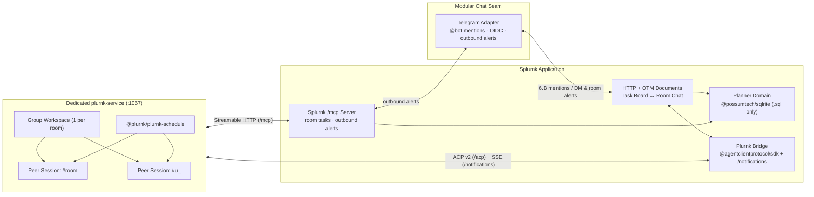

# Architecture

Splurnk is an open-source multi-room social task coordinator within the `plurnk/`
ecosystem. It adapts the accountability loop of Roblox Family Planner to group chat
(starting with Telegram) while delegating agent execution, workspace isolation, and
recurrence exclusively to a custom-configured `plurnk-service` daemon over public
contracts. Missing platform or OTM capabilities are addressed upstream in their
owning packages, never papered over with local shims.

## One owner per fact

| Concern | Authority | Splurnk's responsibility |
|---|---|---|
| Agent turns, logs, context curation, and accounting | `plurnk-service` ({§splurnk-daemon-posture}) | Provision one workspace per room and peer sessions per room/member ({§splurnk-workspace-sessions}); never maintain a parallel agent runtime. |
| Agent protocol, live messages, and session lifecycle | Official ACP v2 SDK (`@agentclientprotocol/sdk`) | Consume `/acp` and `/notifications` through public contracts; never hand-roll JSON-RPC framing (#2). |
| Recurrence rules, timezones, and scheduled agent wakes | `@plurnk/plurnk-schedule` ({§splurnk-schedule-authority}) | Use RFC 5545 / `Temporal` primitives and workspace `schedule` Functionality exclusively; maintain zero bespoke cron or `rrule` wrappers (#4). |
| Rooms, memberships, tasks, submissions, and streaks | Splurnk `Planner` on `@possumtech/sqlrite` | Enforce room/assigner/assignee invariants in `.sql`-backed persistence and expose transport-neutral operations to HTTP routes and `/mcp` ({§splurnk-task-board}). |
| Human authentication | Standard OIDC (`https://oauth.telegram.org`) | Authenticate via Authorization Code + PKCE (`S256`), map immutable `sub` claims, and discard login tokens after session establishment ({§splurnk-identity-oidc}). |
| External chat ingress and outbound notifications | `ChatAdapter` port ({§splurnk-chat-seam}) | Keep Telegram Bot API specifics behind one adapter seam so Slack, Discord, or Matrix adapters invoke the same `Planner` and bridge contracts (#1). |
| Document structure and progressive enhancement | Semantic HTML, native forms, and `on_the_money` | Render semantic HTML enhanced by OTM attributes and four Pico Classless stylesheets (`app-vendor.css`, `app-structure.css`, `app-style.css`, `app-state.css`). |

## Deployment tiers

One unpatched open-source codebase serves three strict operating boundaries ({§splurnk-deployment-boundary}):

| Tier | Example origin | Isolation boundary |
|---|---|---|
| **General OSS / self-hosted** | Operator's domain or `http://127.0.0.1:3400` | Operator supplies their own bot token, OIDC credentials, `SPLURNK_PUBLIC_ORIGIN`, SQLite path, and isolated `PLURNK_SERVICE_STATE_ROOT`. |
| **Dark / staging dogfood** | `https://dev.splurnk.app` | Dedicated staging bot/OIDC client, staging SQLite database, and dedicated staging `plurnk-service` state root and port. |
| **Hosted public & enterprise** | `https://splurnk.app` | Multi-group production database, production `plurnk-service` daemon under `config/plurnk.env`, and group-scoped model/budget tiers (#3). |

No domain name, bot username, or tenant allowlist may be hardcoded in source.

## Configuration authority

Apply the platform's
[configuration authority](https://github.com/plurnk/plurnk-service/blob/main/ARCHITECTURE.md#configuration-authority):
deployment choices live in the owning package's cascading environment ({§splurnk-configuration}).

- `.env.defaults` declares every non-secret Splurnk knob floor, read through `@plurnk/plurnk-meta` `Knob` with no reader-local fallback. Missing floor keys throw immediately; malformed operator overrides raise `ConfigurationError`.
- `config/plurnk.env` declares the non-secret security and execution posture of Splurnk's dedicated `plurnk-service` daemon (`PLURNK_EXECS_ONLY=`, `PLURNK_SERVICE_GIT_ALLOWED=0`, `PLURNK_SERVICE_FILE_CREATE_SCOPE=none`, `PLURNK_SERVICE_MEMBERS_MODEL_SCOPE=none`, `PLURNK_MEMBERS_AUTO_ADD=0`, `PLURNK_SERVICE_PROPOSALS=review`; {§splurnk-daemon-posture}), validated by `plurnk-service config check`.
- Secrets (`TELEGRAM_BOT_TOKEN`, `TELEGRAM_OIDC_CLIENT_ID`, `TELEGRAM_OIDC_CLIENT_SECRET`, `SPLURNK_SESSION_SECRET`, `PLURNK_SECRET`) live exclusively in gitignored `.env.keys` (`0600`) or service environment credentials—never in tracked files, logs, or error payloads.

## Failure and lifetime

- Boundary failures report RFC 9457 Problem Details (`application/problem+json`) or semantic HTML error states without leaking secrets or stack internals.
- Stopping the HTTP server (`SIGINT` / `SIGTERM`) immediately transitions readiness to `503 service-stopping` ({§splurnk-http-lifecycle}), drains in-flight requests within `SPLURNK_STOP_TIMEOUT_MS`, and closes owned resources cleanly without cancelling running loops on the Plurnk daemon.

## Documentation and proof

- `README.md` teaches setup and operation; `AGENTS.md` guides contributors and agents; `ARCHITECTURE.md` owns component boundaries and principles; `SPEC.md` owns current `{§tag}`-governed contracts; Gitea issues own open design investigations and roadmap slices.
- Every deterministic test cites its governing `{§tag}` and exercises real contract boundaries (`plurnk-spec-check`). Unimplemented roadmap contracts reside explicitly in `scripts/spec-witness-allowance.json` and shrink to empty as slices land.
